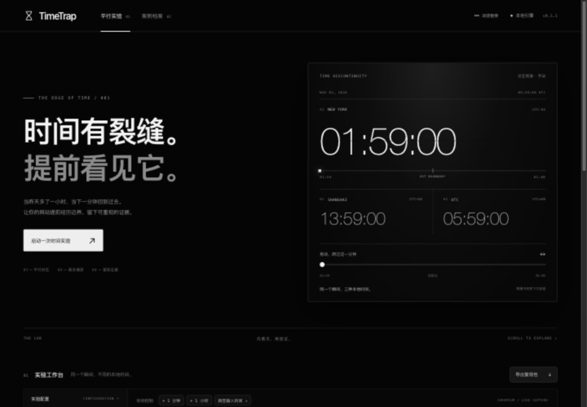

# ◴ TimeTrap

**Put your website through time traps. Keep the evidence.**

A local browser lab for daylight-saving transitions, midnight, leap days, and year boundaries. Run the same page in isolated Chromium timezones, control its clock, compare screenshots, and export an executable reproduction.

[中文使用说明](README.zh-CN.md) · [Case provenance](docs/CASES.md) · [Scope & security](docs/SCOPE.md)



## Quick start

Node.js **22.13+** (24 LTS recommended).

```sh
npm ci
npx playwright install chromium
npm start
```

Open **http://127.0.0.1:4317**. Click **启动一次时间实验**, then **+ 1 分钟**. New York moves from **01:59 to 01:00** while Shanghai and UTC move forward. The countdown advances by 60 seconds in every world.

The interface is currently Chinese. CLI, scenario files and exported reports are usable independently of interface language.

## Bring your own website

1. Enter a reachable HTTP(S) URL, an ISO instant with explicit `Z`/offset, and 1–4 IANA timezones.
2. Start the lab. Each world has an isolated, initially empty browser context.
3. Advance timers or jump the clock. Screenshots are captured after each action.
4. Apply clicks/fills using CSS or Playwright selectors. Add exact-text assertions to declare correctness.
5. Export the ZIP: `report.html`, screenshots, `report.json`, `reproduce.mjs` and replay instructions.

Open `report.html` offline to inspect all frames. Run `reproduce.mjs` in a Node project with Playwright installed to replay against the original URL. The target must remain reachable and provide equivalent initial data.

```sh
# Run the bundled scenario, with npm start running in another terminal.
node src/cli.mjs run examples/scenario.json output/my-run

# Independently reproduce historical cases; no server needed.
npm run cases
```

Scenario files:

```json
{
  "url": "http://localhost:3000",
  "instant": "2026-11-01T05:59:00Z",
  "zones": ["America/New_York", "UTC"],
  "actions": [
    {"type": "advance", "ms": 60000},
    {"type": "click", "selector": "#refresh"},
    {"type": "expect", "selector": "#status", "value": "Ready"}
  ]
}
```

Supported actions: `advance` (timer execution), `jump` (`instant`, date only), `click`, `fill` (`selector`, `value`), `expect` (exact complete element text). CLI exits 1 if an assertion fails. An observation without assertions is **not a correctness pass**.

## Reproductions with passing controls

| Public report | Reproduction scope | Failure / control |
| --- | --- | --- |
| CC Switch #8719 | Original lookback function excerpt at a pinned commit | New York loses a calendar day / UTC passes |
| OpenClaw #130944 | Original `dateBucketId` excerpt at a pinned commit | Los Angeles loses Yesterday / UTC passes |
| react-datepicker #1018 | Rebuilt date-only serialization usage pattern | Positive-offset timezone saves previous date / UTC passes |

These reports are closed historical examples. They are **not newly discovered vulnerabilities**, and this project does not claim to have executed the full upstream applications. Original TypeScript excerpts run after Node strips their types. See [exact sources, licenses and extraction boundaries](docs/CASES.md).

## What this adds

Playwright provides the underlying clock and timezone APIs. TimeTrap packages them into a simultaneous visual lab, boundary presets, source-linked failure examples and a portable evidence/replay bundle. Existing tools such as ChronoMock also manipulate time; this project's focus is reproducible **browser** boundary experiments.

## Verification

```sh
npm run check
npm test
# start npm start separately first
npm run test:browser
```

The browser suite reproduces three failure patterns with UTC controls; checks fall-back and spring-forward transitions, timer behavior versus clock jumps, synchronized input/clicks, mixed assertion results, and actually executes generated scripts to verify both failing and passing assertions. The included Linux GitHub Actions workflow is prepared but was not executed during local development. Local verification: macOS ARM64 + Chromium only.

## Boundaries

Browser main-frame JavaScript time is controlled. Server clocks, token validation on servers, OS time, certificate checks, native applications and cross-origin frames/workers are not verified. Pages use independent storage; authentication and app state must be set up in each context. This is an interactive snapshot lab, not a continuously streamed remote desktop. DOM selectors operate the target; clicking a screenshot enlarges it.

Automatic screenshot differences are not bug judgments. Declare expected behavior with assertions. Time jumps change wall time without running missed timers; advancing time runs scheduled timers. Apps reading remote timestamps can legitimately ignore the local clock.

## Contribute

Add a time trap with a public source, explicit expected behavior, a reproducible failing case, and a passing control. Keep upstream attribution and distinguish source excerpts from rebuilt examples. Start with [docs/CASES.md](docs/CASES.md).

## License

MIT for TimeTrap code. Vendored upstream source remains under its respective MIT notices in `vendor/`. Playwright and fflate retain their own licenses.

## Motion interface (0.1.1)

The monochrome landing view includes a draggable, timezone-correct fall-back preview, independent of the real browser lab. The motion toggle persists the explicit preference. Reduced-motion users start paused; hidden/offscreen previews stop ticking. Capture cards support keyboard zoom and subtle entrance transitions.
